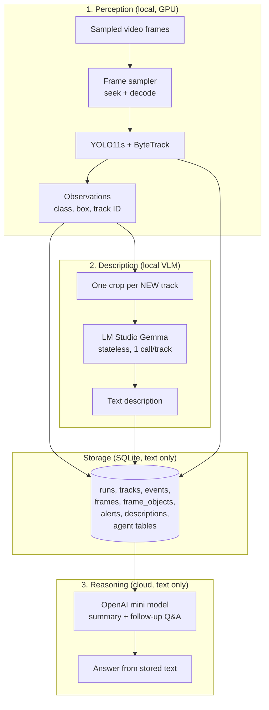
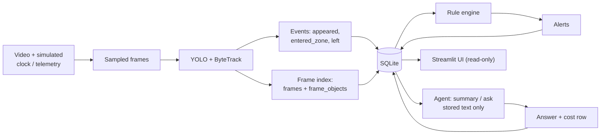
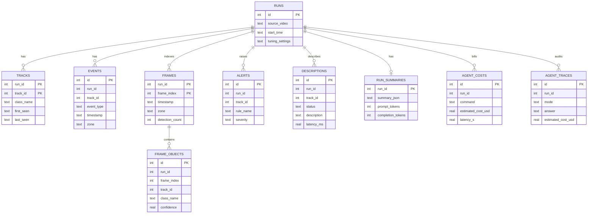
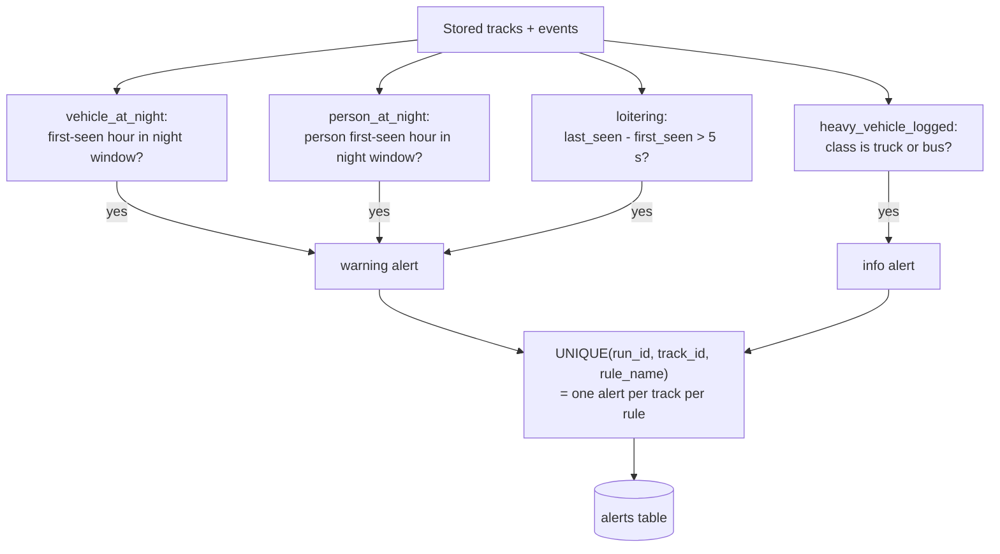
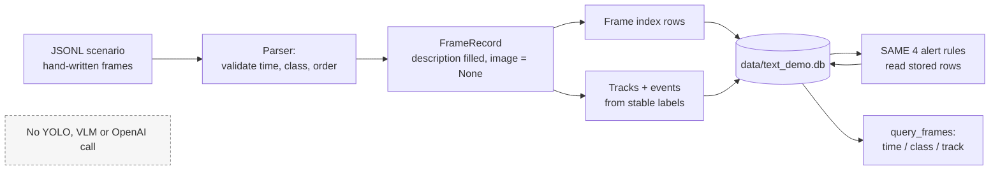

# Architecture and Data Flow

This page embeds the diagrams whose canonical text sources live in `docs/diagrams/*.mmd`.
The Mermaid blocks below are the same source, inlined so GitHub renders them directly.

## Three layers and storage

Perception runs locally on sampled frames and is the only layer that sees pixels. The
description layer sees one crop per newly confirmed track, never every frame, and each
call is stateless. The reasoning layer reads **stored text only** from SQLite, so no
image is ever sent to OpenAI.

## Data flow: video to alerts to agent

Everything is derived from stored rows: alerts are computed from `tracks`/`events` after
storage, and agent answers come from the same database. The UI opens SQLite read-only.

## Database schema

`frames` holds one row per sampled frame; `frame_objects` holds one row per detection.
`agent_costs` is the billing ledger and `agent_traces` is the per-answer audit; both are
written by the agent layer, never by perception or description.

## Alert rule flow

The `UNIQUE` constraint plus `INSERT OR IGNORE` makes alert generation idempotent.
Alerts count tracker tracks, not verified physical objects.

## Text-simulation path

Text mode reuses the storage, frame-index and alert code unchanged, and writes to a
separate database so it cannot disturb the OpenAI cost ledger in `data/demo.db`.

## Syntax check and PNG export

Each block was checked by inspection against Mermaid's flowchart/ER grammar (balanced
quotes and brackets, valid edge and attribute syntax). No Mermaid renderer (`mmdc` /
`mermaid-cli`) is installed in this environment, so **no PNG export was produced and
nothing was installed**. The `.mmd` files render on GitHub when opened as Mermaid, and
the inlined blocks above render in this Markdown file.
