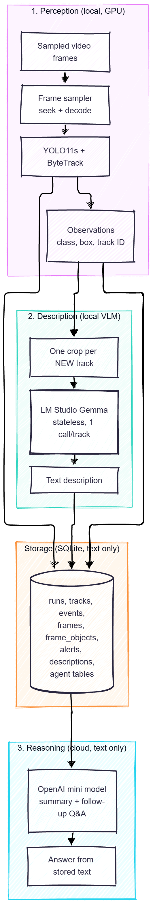
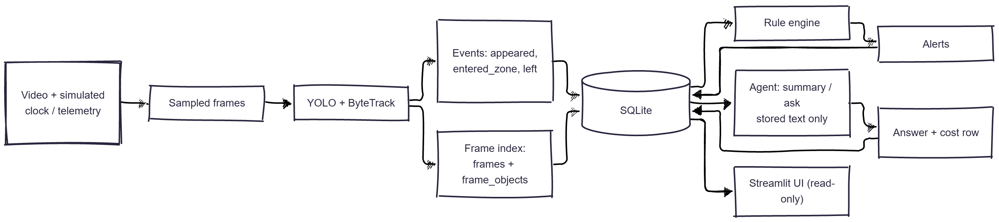
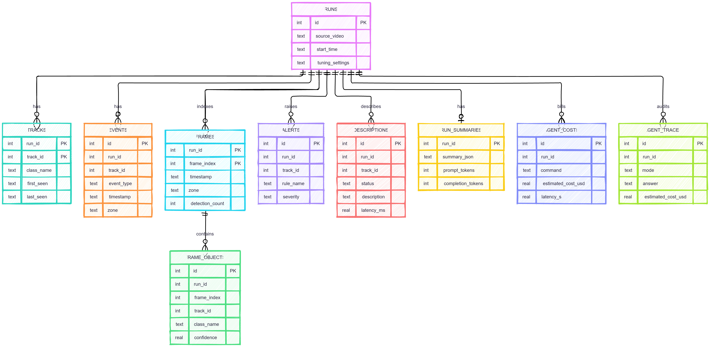
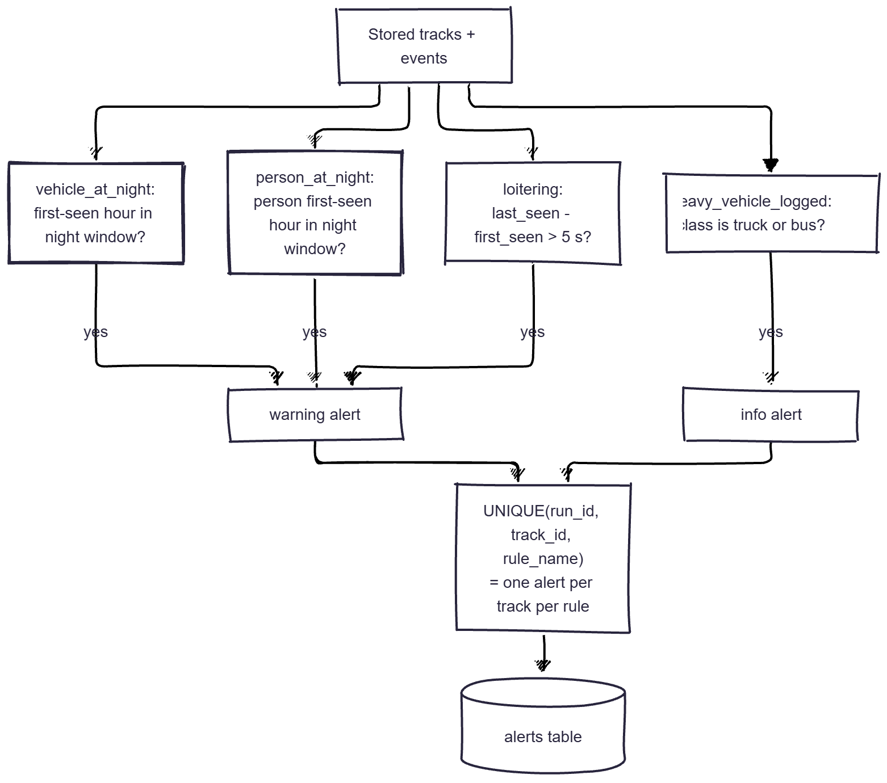
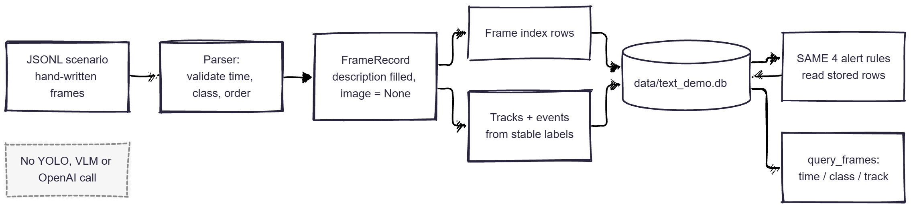
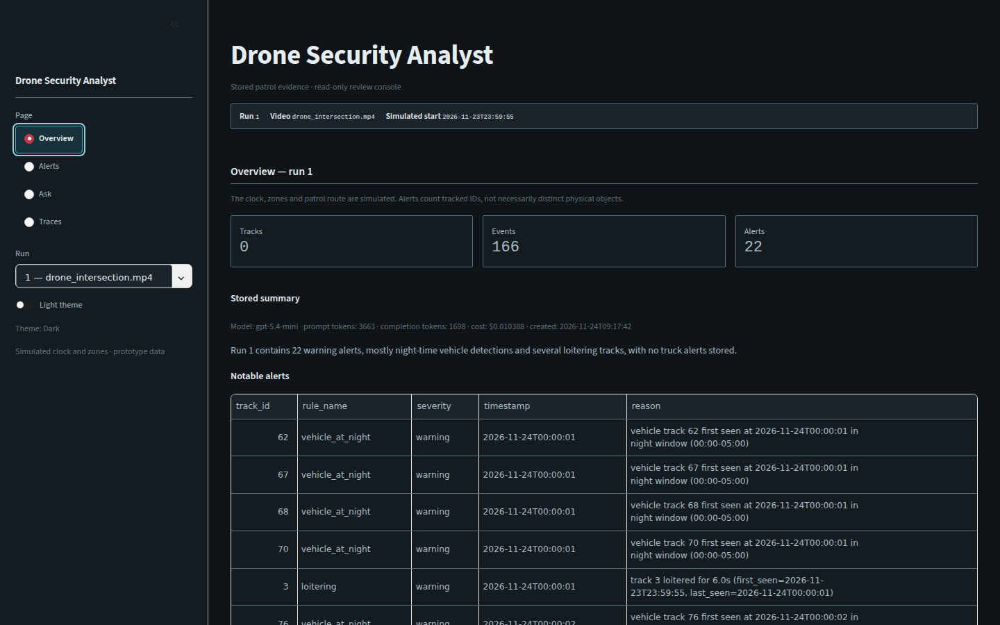
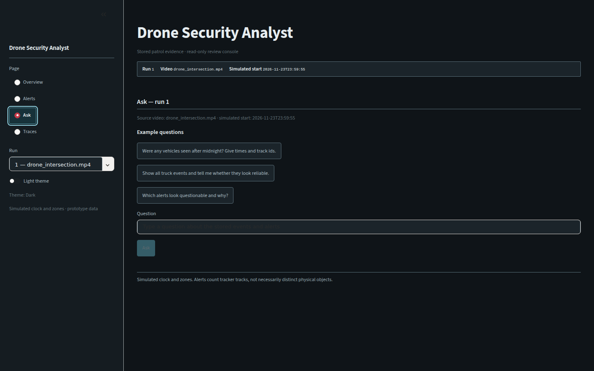
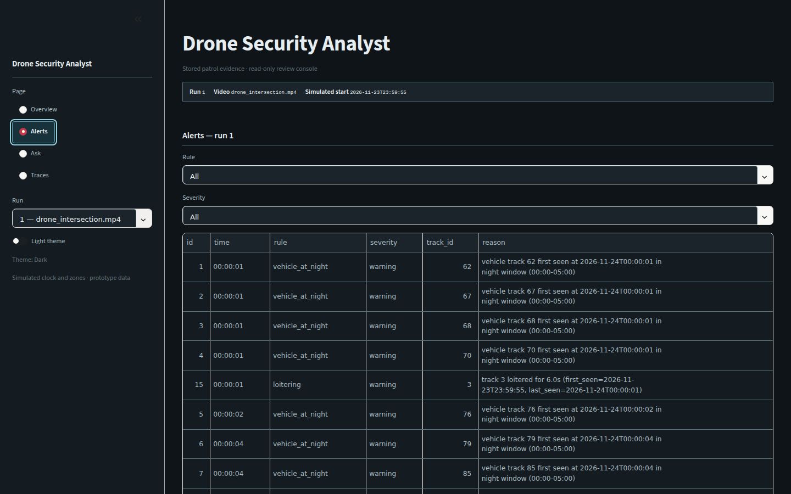

# Drone Security Analyst Agent — Prototype Report

## Summary

We built a working prototype of a drone security analyst agent. It watches sampled drone footage, logs what it sees into SQLite, raises rule-based security alerts, and lets an agent summarize a run or answer follow-up questions from stored text only. A text-simulation mode exercises the same storage, indexing and alert logic with hand-labelled frames and no model calls. The Streamlit UI is read-only, and the agent's answers trace back to stored rows rather than a fresh model guess. No image is ever sent to OpenAI.

Pipeline in one line: YOLO11s + ByteTrack → Gemma 4 E4B via LM Studio on new-track crops → an OpenAI mini model over stored text, with SQLite storage and a Streamlit UI.


## Feature spec

The value to a property owner is an auditable, text-only account of what a patrol drone saw, with alerts and answers traceable to stored rows rather than a fresh model guess. Three requirements are implemented:

- Index every sampled frame by time, object class and track ID in SQLite.
- Raise one alert per confirmed track per rule, with a stored severity and reason.
- Summarize a run and answer follow-up questions over stored text, with token/cost rows and per-answer traces.

These are implemented behaviours, not future claims. The system deliberately counts *tracks*, not verified physical objects; that distinction is carried through the alerts, the answers and the UI.

## Architecture and flow

There are three layers. **Perception** is local and GPU-backed: sampled video frames go through YOLO11s + ByteTrack, producing class, box and track ID. **Description** is also local: one stateless Gemma call is made on the crop of each newly confirmed track, never on every frame, and the text goes into SQLite. **Reasoning** is cloud-based: an OpenAI mini model reads stored text only from SQLite and produces a summary or an answer; it never sees an image. Alerts and the UI also read the database. Agents answers come from stored data, not from re-asking the VLM.

The design has a clear cost and audit consequence. Local detection runs on every sampled frame because that is the only way to build a continuous track and event history. The VLM runs only on new tracks because re-describing an already-known object on every frame would multiply calls without adding information; each call is stateless, so no chat history is carried between crops. Only compact text crosses the boundary to the cloud, which keeps prompts small and makes every answer checkable against a row.

### Three layers and storage



*Figure 1. The three layers and the SQLite store. Perception is the only layer that sees pixels; the reasoning layer reads stored text only.*

### Data flow from video to alerts to agent



*Figure 2. Everything downstream is derived from stored rows. Alerts are computed from tracks and events after storage, and the Streamlit UI opens SQLite read-only.*

### Database schema



*Figure 3. `frames` holds one row per sampled frame and `frame_objects` one row per detection. `agent_costs` is the billing ledger and `agent_traces` the per-answer audit; both are written by the agent layer only.*

### Alert rule flow



*Figure 4. Four rules read stored tracks and events. A `UNIQUE (run_id, track_id, rule_name)` constraint with `INSERT OR IGNORE` makes alert generation idempotent.*

### Text-simulation path



*Figure 5. Text mode reuses the storage, frame-index and alert code unchanged. No YOLO, VLM or OpenAI call is made, and a separate database keeps it away from the OpenAI cost ledger.*

## Prototype

### Telemetry, clock and events

Simulated telemetry supplies altitude, patrol zones (gate, garage, driveway, perimeter) and a configurable clock (`SIM_START_DATETIME`, `TEXT_SECONDS_PER_FRAME`). A run can cross midnight and demonstrate the night rules; a zone is the drone's location, not an image region. The clock is a pure `start + timedelta(video_time)` function, so midnight rollover is deterministic and independent of wall time.

Tracking converts detections into events: `appeared`, `entered_zone` and `left`. A track must be seen in two consecutive sampled frames before `appeared` is emitted; one-frame flickers are suppressed. Zone changes come from the simulated patrol route, so a long-lived track emits repeated `entered_zone` events every time the drone's location changes, even if the object has not moved.

### Alert rules

| Rule | Fires when | Severity |
|------|-----------|----------|
| `vehicle_at_night` | confirmed car/truck/bus/motorcycle track first seen in the night window | warning |
| `person_at_night` | confirmed person track first seen in the night window | warning |
| `loitering` | any confirmed track of any class: `last_seen - first_seen` from the track's own first and last seen times exceeds 5 s, not zone dwell | warning |
| `heavy_vehicle_logged` | track classed `truck` or `bus`, any hour | info |

The loitering rule deserves an explicit note: it applies to **any confirmed track of any class** and is measured from **track duration**, not zone dwell. Because it spans all events for a track, a gap between two visits is included; a truck seen at 12:00 and again at 16:01 is reported as one long dwell. Night-window and loiter thresholds are constants (`NIGHT_WINDOW_START=0`, `NIGHT_WINDOW_END=5`, `LOITERING_THRESHOLD_S=5`), and a window whose start hour is greater than its end hour wraps midnight. Two real stored lines illustrate the output:

```text
# frame index row, data/text_demo.db
frame=3 timestamp=2026-11-24T00:00:00 zone=gate detections=1 description='A person in a dark jacket is now standing at the main gate.'
# alert row, data/demo.db
vehicle_at_night | warning | 2026-11-24T00:00:01 | vehicle track 62 first seen at 2026-11-24T00:00:01 in night window (00:00-05:00)
```

### Frame-by-frame index and example queries

The index has `frames` (one row per sampled frame, full ISO timestamp, zone, detection count, nullable description) and `frame_objects` (one row per detection, with track ID, class, confidence and box). Storing every detection, including one-frame detections that never become confirmed tracks, is deliberate; forcing equality with `tracks` would mean deleting real detections. The backfill check therefore requires only that every confirmed ID is present and reports extras as unconfirmed detections.

Queries are read-only and row-limited, by time window, class or track:

```bash
.venv/bin/python scripts/query_frames.py --run 2 --class truck --limit 1000
.venv/bin/python scripts/query_frames.py --db data/text_demo.db --run 1 --from 2026-11-23T23:59:00 --to 2026-11-24T00:03:00 --limit 1000
```

The first lists frames and detections of a class with distinct track IDs; the second is a window crossing midnight, which needs no special handling because timestamps are full ISO 8601 date-times. `--track N` selects all frames for one track.

### Agent

The agent offers a one-sentence summary, follow-up Q&A and an audit trail. A cached summary is returned without a model call; `--force` regenerates it. For `ask` and uncached `summary`, a compact digest of stored rows (alerts, truck tracks, truck events, descriptions, event counts, each with explicit totals and truncation flags) is preloaded into the user prompt, and the model can then call read-only tools in a loop. Tool choice is `auto`, with a round cap. When the digest is insufficient, the prompt requires the model to call a matching tool before saying the data cannot tell.

Every answer writes a trace row with mode, question, tool calls, the answer text exactly as shown, tokens, cost, latency and a cached flag. `agent_costs` remains the billing ledger; the running total is queried back from SQLite, not held in memory. In real checks, one trace recorded `tools=[none]` because the answer came entirely from the preloaded digest, and after the prompt fix a question about track 47 recorded `tools=[get_events_for_track]` and returned all 10 stored events. Summaries and answers were checked row by row: no invented track IDs were found, though the model sometimes under-flagged a questionable truck track and one answer paraphrased "brick building facade" as "multi-story building" while keeping the meaning.

## Experiments and results

All numbers in this section come from measurements already recorded in `docs/testing.md`; no new measurement, OpenAI call or LM Studio call was made for this report.

### Tracker and sampling tuning

The tuning log records six benchmark variants in three groups, all on the same dense night street scene with no available ground truth. Detection counts are the model's own.

| Group | Settings compared | Finding |
|-------|-------------------|---------|
| Sampling rate | 5 / 10 / 15 fps with the default `bytetrack.yaml` | Unique IDs rose 52 → 58 → 70 and mean track duration fell 3.75 → 3.60 → 3.05 s. Higher fps did **not** reduce fragmentation. Decode dominated at about 350 ms per sampled frame, 8–10× the YOLO time. |
| Association | `match_thresh` 0.8 vs 0.9 at 10 fps | The looser 0.9 threshold cut unique IDs 58 → 48, raised mean duration 3.60 → 4.50 s and halved sub-0.5 s tracks 19 → 11. |
| Confidence / model | A: yolo11n conf 0.10; B: yolo11s conf 0.25; C: yolo11s conf 0.10, all at 10 fps with match 0.9 | A gave 45 IDs and a 5.68 s mean track but the van reached only 109/141 frames at conf 0.341. B gave full 141/141 van coverage at conf 0.873 but more flicker (57 IDs). C was the middle ground: 54 IDs, 5.96 s mean track, van 141/141 at conf 0.873. |

Chosen defaults: **yolo11s, conf 0.10, imgsz 1280, 10 fps sampling, ByteTrack `match_thresh` 0.9**. The 5 fps default had been a guess the data neither supported nor contradicted; 10 fps is a practical ceiling here because decode, not detection, dominates. Distant traffic still switches IDs in crowded scenes, and tiled inference remains untried.

### VLM comparison

Five vision models already available in LM Studio were compared on the **same 10 stored run-2 crops** (five YOLO truck tracks and five car tracks), with stateless calls, temperature 0 and a JSON schema. All returned valid JSON 10/10 times. No accuracy score is claimed: LM Studio supplies no ground truth.

| Model | Mean latency | Median latency | Valid JSON |
|-------|--------------|----------------|------------|
| `google/gemma-4-e4b` | 1542.5 ms | 1459.7 ms | 10/10 |
| `google/gemma-4-e2b` | 2667.0 ms | 1202.5 ms | 10/10 |
| `google/gemma-3-12b` | 60157.0 ms | 41251.2 ms | 10/10 |
| `qwen/qwen3.5-9b` | 15721.3 ms | 12613.8 ms | 10/10 |
| `qwen/qwen2.5-vl-7b` | 3286.0 ms | 1240.6 ms | 10/10 |

**Cold-load caveat:** latency includes model loading on the first call of each model, which is why the means for larger models sit far above their medians; the first `gemma-3-12b` call took 171405 ms. In steady state three models are close (roughly 1.2–1.5 s median), while `qwen3.5-9b` (12.6 s) and `gemma-3-12b` (41.3 s) are far slower.

The "By eye" column in the source comparison was **first drafted by the assistant from the crop files and then checked by the human (the project owner) against those crops**. It is one person's visual reading, not independent ground truth, and no accuracy score is claimed. Under an explicit keyword rule — "agreement" means the stored description says vehicle/truck/van/car for a YOLO vehicle class, while silence or a non-vehicle noun is "disagreement" — the chosen `gemma-4-e4b` agreed on **4 of 10** crops. This is a qualitative reading of stored text, not a measured accuracy number.

The practical finding is that YOLO and VLM text **cross-check each other**. YOLO supplies counts and classes; VLM text is fallible context. The VLM correctly rejected painted containers (track 326) and a building (track 410) that YOLO had classed as trucks, while it missed a clearly blue-cabbed truck (track 2) and a red box truck (track 103) as vehicles. Other models named 103 a truck and 326 containers, but one called truck crop 2 a "building" and another read building crop 410 as a "grey vehicle". Neither source is ground truth on its own.

### Measured weaknesses

- The chosen VLM **under-identifies large trucks**, describing them as buildings or containers rather than vehicles. In the run-2 truck-class set, only one of six descriptions could reasonably be considered a genuine truck; the other five `heavy_vehicle_logged` alerts are effectively false positives from the rule's class-only perspective.
- In run 2, **12 of the 23 tracks had crops too small** for the VLM and were skipped; only 11 were described.
- Neither demo clip produced a confirmed person track, so `person_at_night` is verified on fake data only.

### Scalability

Per-stage timings are means per sampled frame on the two real clips; "first" includes model and tracker load.

| Clip | Frames | Decode mean / median / first | YOLO+ByteTrack mean / median / first | Index build | Event build |
|------|--------|------------------------------|--------------------------------------|-------------|-------------|
| drone_intersection.mp4 | 167 | 152.925 / 150.858 / 195.281 ms | 40.848 / 21.033 / 3209.722 ms | 0.010 ms | 0.013 ms |
| drone_truck.mp4 | 184 | 186.017 / 181.213 / 147.497 ms | 24.007 / 21.459 / 93.098 ms | 0.010 ms | 0.010 ms |

Excluding the first frame, steady-state YOLO+ByteTrack was 21.758 ms and 23.629 ms; decode was roughly 7–8× slower. Database writes were under 0.05 ms per frame. Total measured stage time gives **5.159 and 4.760 sampled frames/s (0.514× and 0.474× real time)**, about 0.20 s per sampled frame end to end.

**Seek versus sequential decode.** Both methods collected the identical set of sampled frames in a benchmark script only; no pipeline code changed.

| Clip | Source frames | Seek total / ms per sampled frame | Sequential total / ms per sampled frame | Sequential faster by |
|------|---------------|-----------------------------------|------------------------------------------|----------------------|
| drone_intersection.mp4 | 499 | 29.386 s / 175.962 ms | 0.707 s / 4.232 ms | 41.6× |
| drone_truck.mp4 | 440 | 37.275 s / 202.580 ms | 0.685 s / 3.724 ms | 54.4× |

Repeated frame-index seeks are the bottleneck: sequential decoding is **42–54× faster** (rounded) but is **not implemented** in the pipeline.

**Index growth** from the real rows, measured as incremental file-size deltas in a scratch database using the production write path:

| Run | Frames | frame_objects | Rows / frame | Incremental bytes | Bytes / frame | Bytes / object |
|-----|--------|---------------|--------------|-------------------|---------------|----------------|
| 1 | 167 | 1287 | 7.707 | 184320 | 1103.7 | 143.2 |
| 2 | 184 | 868 | 4.717 | 126976 | 690.1 | 146.3 |

**SYNTHETIC, NOT VIDEO.** Query latency was measured on generated databases with 5 detections per frame, 50 cyclic track IDs, 5 classes and 10 fps timestamps; each number is the median of five warmed calls with a 50-row limit.

| Frames (objects) | Time window no idx / idx | Class=truck no idx / idx | Track=42 no idx / idx |
|------------------|--------------------------|--------------------------|------------------------|
| 10k (50k) | 1.224 / 0.030 ms | 10.464 / 9.774 ms | 3.895 / 1.534 ms |
| 100k (500k) | 12.972 / 0.030 ms | 112.764 / 111.281 ms | 39.350 / 16.171 ms |
| 1M (5M) | 130.182 / 0.029 ms | 1161.863 / 1155.677 ms | 389.911 / 173.145 ms |

The `(run_id, timestamp)` index keeps time windows flat at about 0.03 ms even at 1 M frames; the track index roughly halves per-track lookups. The class query barely improves because `COUNT(DISTINCT frame_index)` over about 1 M matching objects dominates regardless of index.

**VLM cost scales with new tracks, not frames.** Run 1 made 33 calls for 33 tracks (0 too small, 19.76 calls per 100 frames, 40.61 s stored latency total, 1.230 s mean per call); run 2 made 11 calls for 23 tracks (12 too small, 5.98 calls per 100 frames, 13.72 s, 1.247 s mean). A tracker split that turns one object into *k* IDs multiplies VLM calls by *k*, while doubling the sample rate does not add calls for an already-described track. The stored latency sums are slightly below the earlier wall totals (42.37 / 14.59 s) because of database-write and parse overhead outside the recorded latency.

**Agent cost per question:** over 15 `ask` cost rows, the average was 3789.1 prompt tokens, 305.4 completion tokens, **$0.00421615 and 2.512 s**. Across all 19 cost rows the totals were 71097 prompt + 9561 completion tokens and **$0.09634725**; the running total is read from SQLite and no warning ($0.50) or cap ($1.00) was reached.
 By submission, further Ask calls brought the database to 25 cost rows totalling $0.13209075, still under the cap.

**EXTRAPOLATION, NOT MEASURED.** None of the following was run; all arithmetic uses the measured numbers above:

- One hour at 10 fps sampling is 36000 frames. At the measured mean of 0.2020 s per frame that is **7272 s ≈ 2.02 h** as written (about 2× slower than real time). With the unimplemented sequential decode (~4 ms instead of ~170–186 ms) it would be about **1296 s ≈ 21.6 min**.
- VLM calls for that hour: at run-1 density 7114 calls ≈ 2.43 h of VLM time; at run-2 density 2153 calls ≈ 45 min. The spread is the message: call count depends on fragmentation and crop size, not frame count.
- Index size: 39.7 MB at run-1 density or 24.8 MB at run-2 density, excluding alerts and descriptions.
- 100 agent questions: about **$0.42** at the ask-only average and 251 s of model latency, assuming the bounded digest keeps prompt size roughly flat — an assumption, not a measurement.
- Ten drones at 10 fps each demand 100 sampled frames/s. Against measured single-stream capacity of about 4.9 frames/s that is roughly **20.4 GPU-equivalents** on this hardware, or about **3.6** with sequential decode. Serving ten streams on one GPU is unmeasured and would contend for 8151 MiB of VRAM.

## Testing

The full suite reports **99 passed**. Model calls sit behind small interfaces, so the core logic runs without a GPU, LM Studio or OpenAI: the suite uses fake model clients and temporary databases. Two named scenario tests in `tests/test_agent.py` cover the **midnight alert** (`test_scenario_midnight_vehicle_and_fake_agent`: a car at 23:59:58 fires no night alert, one at 00:00:03 does) and the **truck logged correctly** (`test_scenario_truck_logged_and_fake_agent_cites_track`: one `heavy_vehicle_logged` info alert, idempotent on a second run, with the fake agent citing the track ID). Both run with no model call.

Text-simulation mode is hand-labelled JSONL with `confidence=1.0` and placeholder boxes; it tests the alert and index logic only, **not vision**. It makes no YOLO, ByteTrack, VLM, LM Studio or OpenAI call, reuses the same four rules and frame index, writes to a separate database, and covers parser errors, one track per label, midnight and truck alerts, a quiet negative control, idempotency, and queries by window, class and track.

## Limitations

- **Occlusion and ID switches.** ByteTrack switches IDs in crowded or occluded scenes, so alerts count tracks, not verified objects. One physical object split across IDs becomes several alerts; two objects sharing an ID become one.
- **VLM weakness on large trucks.** The chosen VLM under-identifies them as buildings or containers, and its "By eye" comparison is one person's reading without ground truth.
- **About 0.5× real time.** Frame-index seeking makes the pipeline roughly 0.51× / 0.47× real time; decode, not YOLO, dominates.
- **Simulated clock and zones.** Time, altitude and patrol zones are simulated, not measured from footage; zone is the drone's location, so repeated `entered_zone` events do not show object patrolling or dwelling. `person_at_night` checks only the hour of `first_seen`, so a person present from 23:59 would not fire it.
- **Small objects from altitude are often missed.** This is an observation, not a measured rate; a raw YOLO probe found far more car detections per frame than the tracker stored as tracks.
- **Loitering simplification.** The rule measures `last_seen - first_seen` across all events for any confirmed track, including gaps between visits, rather than continuous presence or zone dwell.
- **Index semantics.** A class query is a detection-level query: per-frame class votes can disagree with a track's stored class, so "truck frames" can include IDs listed as `car` in `tracks`.

## Future work

- **Apply sequential decode in the pipeline.** It measured 42–54× faster in the benchmark, but is **not implemented**. It is the single largest available win for throughput.
- **Fine-tune a small vision-language model or the detector on labelled aerial crops** to improve recognition of small, blurry and large vehicles. This is **not implemented or measured**.
- Tiled/sliced inference (SAHI-style) is the obvious untried lever for small objects, and `person_at_night` could be changed to check presence anywhere in the night window rather than only the first-seen hour. Neither was done in this prototype.

## AI tools used

The opencode assistant wrote code, tests and documentation, ran no-model checks and interpreted failures; an external assistant helped plan steps and tuning; six installed design skills guided the Step 9B UI work; the human made scope decisions, verified the visual "By eye" reading and chose between options when failures were found. Nothing was trusted without a real run. The assistant drafted the "By eye" column from crop files and the human checked it; no accuracy score is claimed. The per-step record, including what each tool produced and what it did not, is in `docs/ai-tools-log.md`.

## Sample clip provenance

Source of the two sample clips: downloaded from Pexels (pexels.com, aerial video search). The individual clip page links were not recorded.

## UI screenshots

34 themed and responsive screenshots from the Step 9B design pass are kept in `docs/screenshots/`.

Three representative captures (Overview, Ask and Alerts) are embedded below. They are read-only views of the stored demo data.



*Figure 6. Overview page: run counts and stored summary.*



*Figure 7. Ask page: follow-up question over stored text.*



*Figure 8. Alerts page: stored rules, severities and provenance.*
